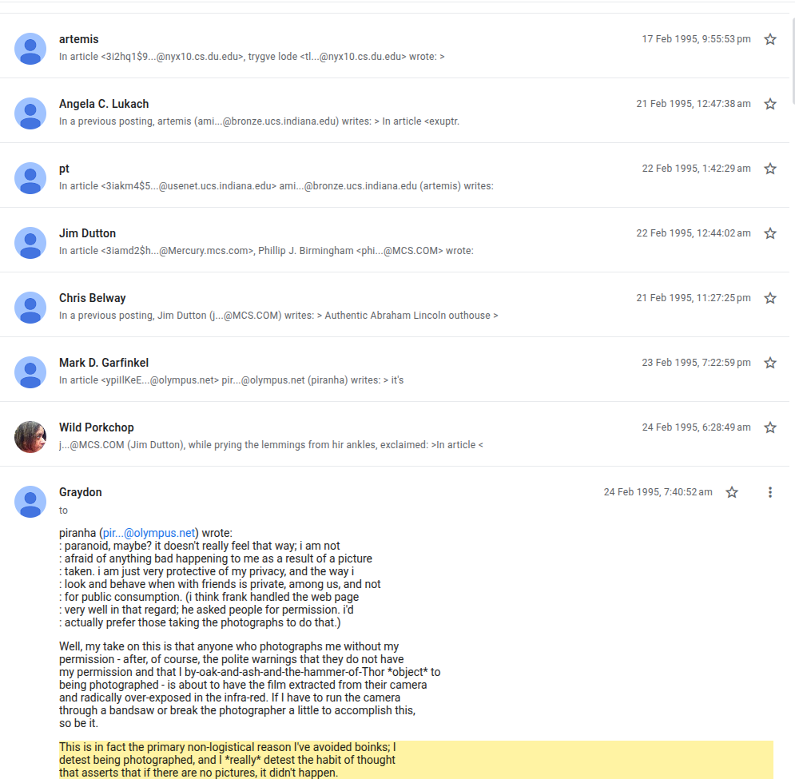

# Where "pics or it didn't happen" came from: Usenet, February 1995

## The discovery

**24 February 1995, Usenet group `soc.singles`, thread "Boink List".** Poster **Graydon** (`saun…@qlink.queensu.ca`, Queen's University) explains why he avoids "boinks", the in-person meetups of soc.singles regulars, where photos were taken and passed around afterwards:

> "This is in fact the primary non-logistical reason I've avoided boinks; I detest being photographed, and I \*really\* detest the habit of thought that asserts that **if there are no pictures, it didn't happen**."

- Original post: https://groups.google.com/g/soc.singles/c/LA8Jykgy7XA ([Wayback snapshot](http://web.archive.org/web/20261028183732/https://groups.google.com/g/soc.singles/c/LA8Jykgy7XA); Graydon's message is dated **24 Feb 1995, 7:40:52 am** in the Google Groups/Deja Usenet archive)
- He calls it a "habit of thought", not his own coinage. So by February 1995 the idea that an event without pictures "didn't happen" was already a known attitude in that community.

**Date evidence beyond one timestamp.** The sentence is quoted in later replies in the same thread, each with its own archive date: David E. Brown (25 Feb 1995, 5:50 am), "piranha" (25 Feb 1995, 8:34 pm), Graydon again (26 Feb 1995), and David E. Brown (26 and 27 Feb 1995). The thread starts 17 Feb 1995 and every message sits in order around it. Google Groups shows these times in the viewer's time zone; the dates are what matter here.

## The earliest uses, in order

| Date | Where | Text | Link |
|---|---|---|---|
| 24 Feb 1995 | Usenet soc.singles, "Boink List" (Graydon) | "the habit of thought that asserts that if there are no pictures, it didn't happen" | [thread](https://groups.google.com/g/soc.singles/c/LA8Jykgy7XA), [Wayback](http://web.archive.org/web/20261028183732/https://groups.google.com/g/soc.singles/c/LA8Jykgy7XA) |
| 21 Aug 1995 | Usenet bit.listserv.scuba-l, "need 3 hands for night dives" (Robert "Bob" Huckabee, to an underwater-photo diver) | "Don't forget to get a picture of your drowning **or it didn't happen**." | [message](https://groups.google.com/g/bit.listserv.scuba-l/c/1qLjUnxR3BU/m/MiIQf2jcGpYJ), [Wayback](http://web.archive.org/web/20261028183413/https://groups.google.com/g/bit.listserv.scuba-l/c/1qLjUnxR3BU/m/MiIQf2jcGpYJ) |
| 29 Aug 2002 | Usenet or.politics / pnw.general, "'Peaceful' Protesting" | "So there must be **photos or it didn't happen**?" | [message](https://groups.google.com/g/or.politics/c/qRHJITrADlw/m/KpSDdVAcyB8J) |
| 20 Jun 2003 | Tribal War forums (the *Starsiege: Tribes* community), "So my sister has her hot friend over" | "Obligatory '**pix or it didn't happen**.'" | per [Know Your Meme](https://knowyourmeme.com/memes/pics-or-it-didnt-happen) |
| 3 Oct 2004 | Usenet alt.games.champ-man, "Arsenal Fight Club" | "**pics or it didn't happen**..." | [message](https://groups.google.com/g/alt.games.champ-man/c/mSswMIE0Oh0/m/_rT3trfLnykJ) |
| 30 Sep 2005 | Usenet alt.games.starsiege.tribes | "**As we say in the game, pics or it didn't happen**" | [message](https://groups.google.com/g/alt.games.starsiege.tribes/c/3E_Iahbr7h8/m/_Obm90qaY-0J) |

How it spread: an attitude named in 1995 (Usenet meetup culture), a joke format by mid-1995 ("get a picture … or it didn't happen"), then the fixed short form in gaming communities. The 2003 "**Obligatory** 'pix or it didn't happen'" already treats it as a stock reply, and in 2005 a *Tribes* player calls it what "we say in the game". That ties its popular form to the *Starsiege: Tribes* scene that ran Tribal War, from where it spread across forums in 2004 (Know Your Meme lists Metafilter, Something Awful and others).

## Investigation

1. Searched the full Usenet archive on Google Groups (`groups.google.com/search`) with exact phrases and its `before:` date operator. I confirmed the operator works: `"pix or it didn't happen" before:2010-01-01` returns 80 conversations.
2. **Negative results** (all before 20 Jun 2003, 0 conversations each): "pix or it didn't happen", "pics or it didn't happen", "pictures or it didn't happen", "pix or it never happened", "pics or it never happened", "pix/pics or it didnt happen", "picture or it didn't happen", "photo or it didn't happen", "pictures or it never happened". So no exact modern form appears on Usenet before the Tribal War post.
3. Broadened to the construction ("or it didn't happen" + pics/pix/photos; "no pictures" + "it didn't happen"). That surfaced the 1995 soc.singles and scuba-l posts and the 2002 one. Nothing related before 24 Feb 1995 ("no pictures" + "it didn't happen" before that date returns only unrelated uses).
4. Read each thread in full to confirm authorship, wording and dates (screenshot above). Archived both 1995 threads on the Wayback Machine (links in the table).

Swift Bot Labs · research note, October 2026
